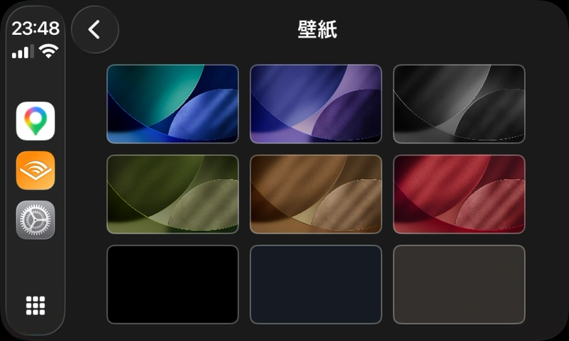

<p align="center">
  
</p>

<h1 align="center">CarCanvas</h1>

<p align="center">
  <a href="README.md">English</a> ·
  <a href="README.zh.md">简体中文</a> ·
  <strong>日本語</strong>
</p>

<p align="center">CarPlay の壁紙キャッシュをカスタム CPBitmap で上書きするツールです。</p>

## 1. これは何か

CarCanvas は CarPlay の壁紙キャッシュを上書きするためのツールです。CarPlay は起動のたびに壁紙を一から生成するのではなく、事前に生成済みのキャッシュファイルを読み込みます。本アプリはそのファイルをカスタム CPBitmap で上書きします。デバイスにキャッシュファイルが存在しない場合、上書き対象はありません。

## 2. このリポジトリの現在の姿

これは Swift + SwiftUI + Objective-C でゼロから書き直した、完全なオープンソースのソースコードプロジェクトです。プリビルド IPA だけを配布するリリースツリーではありません。

- このリポジトリには **いかなる IPA も含まれません**。`*.ipa` は `.gitignore` で除外され、`build/` にはプレースホルダの README だけが置かれています。
- IPA は `.github/workflows/build-ipa.yml` により GitHub Actions 上でビルドされ、workflow artifact としてダウンロードします。リポジトリにはコミットされません。

## 3. バックエンド：worse_query

コンテナアクセス用バックエンドとして [forcequitOS/worse_query](https://github.com/forcequitOS/worse_query) を `vendor/worse_query/` に vendored として組み込みました。`com.apple.mobile.MobileHouseArrest` の identity に依存していた旧版の MobileHouseArrest / FilzaSlop 方式を置き換えるものです。

| 項目 | 状態 |
| --- | --- |
| 上流が主張する互換範囲 | iOS 26.0 – 26.7.2、および 27.2 |
| 本プロジェクトが有効にする範囲 | iOS 26.0 – 26.7.2、および 27.0 – 27.2（下流では 27.2.1 まで実測） |
| Apple による確認 | なし。上流 PoC の互換性主張であり、Apple の公式発表ではない |
| CVE 番号 | 確認されたものはなし |
| 範囲外・未判別のバージョン | 起動時に fail-closed、コンテナアクセスは試行しない |

アプリは起動時にバージョンゲートを行います。有効範囲外のシステムバージョン、および判別できないシステムバージョンでは一律**失敗閉じ（fail-closed）**となり、サンドボックス拡張の取得もコンテナアクセスも試みません。

これはカーネル脆弱性を利用するものでは**なく**、脱獄でも**なく**、root を提供せず、他プロセスへのインジェクションを行わず、ネットワークに接続せず、データをアップロードしません。

セキュリティ境界：写真の置き換えは、特定した `com.apple.CarPlayWallpaper` コンテナ内の明示的に選んだ既存の許可ファイルだけを書き込みます。クエリ／LaunchServices の対応情報と限定的な識別プローブでコンテナを確認し、他の App の文書は閲覧しません。任意パス入力や汎用ファイルマネージャはありません。写真と復元はアプリ内に一時保存し、「適用」の確認後にファイルごとに書き込みます。置き換え前にバックアップし、書き込み後にバイト単位で検証します。明示的な復元だけが、既存の固定キャッシュディレクトリにそのバックアップ名のファイルを再作成できます。保留中／適用済みの状態は NeoSpring の要求前に保存します。一部失敗時は成功分の状態と失敗分／残りの一時保存を保持し、自動ログアウトしません。**実機検証が必要です。**

## 4. CPBitmap の生成方法

Apple は `.cpbitmap` を文書化しておらず、公開デコーダの見解も分かれています。既存キャッシュのプレビューはシステムの読み取りを優先し、検証済みの生テンプレートによるデコードにフォールバックします。保持するのは小さなサムネイルだけです。

選んだ写真はバックグラウンドで変換します。まず動的に解決したシステムの `writeToCPBitmapFile:flags:` を使い、使用できない場合や失敗時は**正確に選んだキャッシュファイル**を有効なテンプレートとして使用します。ピクセル領域だけを置き換え、完全なメタデータ／末尾は保持します。別のダーク／ライトのファイルは代用しません。BGRA／RGBA の設定はテンプレート経路だけに適用します。変換結果と小さなプレビューはアプリ内の `StagedWallpapers/` に保存し、「適用」までシステムキャッシュは書き込みません。両方の経路に実機検証が必要です。

## 5. バージョン要件

| 項目 | 要件 |
| --- | --- |
| 対応 iOS | 26.0 – 26.7.2、27.0 – 27.2 |
| Deployment target | 26.0 |
| ビルド環境 | Xcode 26.x |
| 旧版 iOS | 非対応（バックエンドを変更したため） |

旧版 iOS はコンテナアクセス用バックエンドが変わったため非対応です。対応範囲は第 3 節の**上流の主張**に基づきます。

## 6. 署名と App Group（重要）

**グループ名は重要ではありません。署名したツールが入れたものが使われます。** CarCanvas は実行時に `SecTaskCopyValueForEntitlement` で自分自身の署名から `com.apple.security.application-groups` を読み取り、`containerURL(forSecurityApplicationGroupIdentifier:)` を順に試して実際に開けたものを使います。WQFiles と Regitela と同じ方式なので、ソース内のプレースホルダを書き換える必要はありません。

- CI が生成するのは**未署名 IPA** で、そのままではインストールできません。entitlement はコード署名の中にあるため、未署名ビルドには App Group がなく、コンテナに到達できません。
- **推奨**: [Impactor](https://github.com/claration/impactor/releases)、AltStore、SideStore で署名します。Apple ID 用の App Group を自動で作成し保持します。
- 証明書（`.p12`）+ profile で署名する場合、profile に App Group が必要です。市販の多くはワイルドカード profile（App ID `*`）で App Group を含められず、署名に失敗するか実行時に "no accessible app group" になります。
- Sideloadly は App Group を**付与しません**。それで署名したビルドは "NONE" と表示します。
- 自分のアカウントで行う場合: Developer ポータル → Identifiers → App Groups で作成 → そのグループを有効にした明示的 App ID を作成 → profile を生成 → その profile で署名。
- `CarCanvas/CarCanvas.entitlements` の `group.example.carcanvas.wq` は Xcode 用の既定値にすぎません。自分のチームのグループに置き換えるか、署名ツールによる注入に任せてください。
- 前回の実行が中断された場合、App Group の `Library/Caches` がシンボリックリンクのまま残り、以降のクエリがすべて失敗します。起動時に検出し、邪魔なものを**リネームして退避**（削除はしない）してからディレクトリを作り直します。

## 7. ビルド

ローカル：

```sh
brew install xcodegen && xcodegen generate && open CarCanvas.xcodeproj
```

CI は `.github/workflows/build-ipa.yml` で同じツールチェーンを自動実行します。`scripts/build-unsigned-ipa.sh` はコンパイル後に `en` / `ja` / `zh-Hans` の 3 セットの `.strings` を手動で bundle に注入し、`Payload/` 構造の ipa にパッケージして完全性のセルフチェックを行います。

`scripts/verify-repository.py` はローカルの検収スクリプトです。禁止された配布成果物、3 言語の key／プレースホルダ一致、実行時の App Group 検出、キャッシュ変更の UI／安全境界の回帰規則を検証します。iOS のビルドや実機テストの代わりにはなりません。

```sh
python3 scripts/verify-repository.py
```


> **注:** `xcodegen generate` の後に Xcode から直接実行すると `.lproj` は注入されず、`L(...)` のキー名がそのまま表示されます。ローカライズ済みビルドには `scripts/build-unsigned-ipa.sh` または CI ワークフローを使用してください。

## 8. 使い方（5 ステップ）

1. CarPlay の**設定 → 壁紙**で、上 2 段の模様付き壁紙 6 枚を一度ずつ選びます。下段の単色 3 枚はキャッシュを生成しません。

   

   CarCanvas の **CarPlay** タブで「再試行」をタップします。数字の接尾辞を含む実際のファイル名を保持します。同名のダーク／ライトは表示上グループにするだけで、自動的にペアで上書きしません。タブは **CarPlay／設定** のみです。
2. 置き換えたい**正確なファイルの左側のプレビュー**をタップして写真を選びます。ダーク／ライトの切り替えは不要です。バックグラウンドで変換して一時保存し、アプリを開き直しても選択とプレビューは残ります。まだシステムキャッシュは変更しません。
3. 「再試行」が保留中のファイル件数付きの**適用**に変わり、復元も件数に含みます。プレビュー右側の**クリア**はその保留中の変更だけを取り消し、システムキャッシュやバックアップは削除しません。「適用」を確認すると保留中のファイルだけを書き込み、成功分の状態を保存してから NeoSpring で画面の再読み込みを試みます。一部失敗時は自動ログアウトせず、成功分は適用済み、失敗分と残りは保留のままです。NeoSpring は完全なシステムログアウトではなく、必ず成功するとは限りません。
4. プレビュー右側の**復元**は置き換えを適用済みで、有効な元のバックアップがある場合だけ使えます。**バックアップ**見出し右側の共通の**復元**で全保存原本の復元を一時保存します。その下には情報だけを表示します。復元も「適用」で書き込むか、その前に「クリア」で取り消します。旧コピー／回収したコピーは保存元を表示し、システム原本である保証はありません。
5. **設定 → CarPlay 壁紙キャッシュを削除**は許可されたシステムキャッシュ、全ローカルバックアップと索引、保留中／適用済みの状態を完全に削除します。以前のローカル書き出しと履歴は保持し、自動ログアウトは行いません。手動でログアウトして CarPlay に再接続し、6 つのシステム模様を選び直して「再試行」します。必要なら通常の方法で iPhone を再起動し、標準壁紙の再生成を実機で確認してください。

## 9. 中国語（簡体字）対応

UI には `en` / `ja` / `zh-Hans` の 3 セットのローカライズを `CarCanvas/Resources/` 配下の `.strings` として同梱しています。`CFBundleLocalizations` に `zh-Hans` を宣言済みで、フォトライブラリの権限文言もローカライズ済みです。システム言語が簡体字中国語なら自動的に適用され、アプリ内での言語切り替えは不要です。

## 10. ライセンスと謝辞

メンテナーの連絡先とサポート:

- Telegram チャンネル: [t.me/linkpass666](https://t.me/linkpass666)
- Afdian: [afdian.com/a/linkpass](https://afdian.com/a/linkpass)

本プロジェクトは `worse_query`（`GPL-3.0-or-later`）を利用しているため、全体を `GPL-3.0-or-later` で公開します。GPL-3.0 の全文は [LICENSE](LICENSE)、vendored コンポーネントの説明は [THIRD_PARTY_LICENSES/](THIRD_PARTY_LICENSES/README.md) を参照してください。

謝辞：

- [forcequitOS / Taj C — worse_query](https://github.com/forcequitOS/worse_query)：コンテナアクセス用バックエンド。
- [Dcsyhi/CarCanvas](https://github.com/Dcsyhi1998/CarCanvas)：オリジナルの CarCanvas。

`docs/` 配下の画像は上流の公開リポジトリ由来です。上流リポジトリには明示的なライセンスがなく、権利関係は各自で確認する必要があります。本リポジトリは上流のクローズドソースバイナリを含みません。

## 11. 免責事項

自分が所有し、バックアップ済みのデバイスにのみ使用してください。データ消失、デバイスの不具合、サービス利用規約違反について作者は責任を負いません。これは Apple の公式製品でも Apple が認可した製品でもなく、Apple の承認や実機テスト完了を主張するものでもありません。
