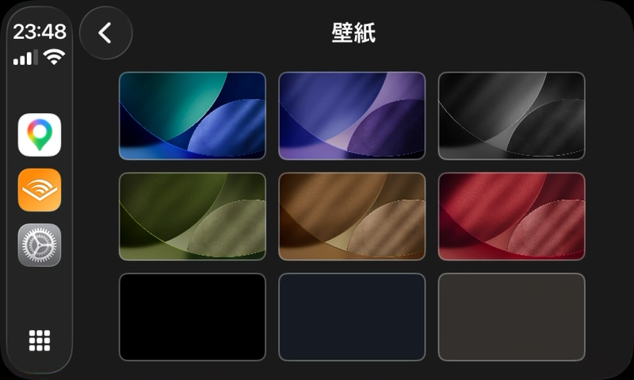

<p align="center">
  
</p>

<h1 align="center">CarCanvas</h1>

<p align="center">
  <strong>English</strong> ·
  <a href="README.zh.md">简体中文</a> ·
  <a href="README.ja.md">日本語</a>
</p>

<p align="center">A tool that overwrites the CarPlay wallpaper cache with a custom CPBitmap.</p>

## 1. What this is

CarCanvas is a tool for overwriting the CarPlay wallpaper cache. CarPlay does not render wallpapers from scratch on every start: it reads cache files that were generated earlier. This app overwrites that cache with a custom CPBitmap. If no cache file exists on the device, there is nothing to overwrite.

## 2. What this repository is now

This is a complete open-source source project rewritten from scratch in Swift + SwiftUI + Objective-C. It is no longer a release tree that only ships a prebuilt IPA.

- This repository contains **no IPA of any kind**. `*.ipa` is ignored by `.gitignore`, and `build/` contains only a placeholder README.
- The IPA is built on GitHub Actions by `.github/workflows/build-ipa.yml` and is downloaded as a workflow artifact. It is not committed to the repository.

## 3. Backend: worse_query

The container-access backend is [forcequitOS/worse_query](https://github.com/forcequitOS/worse_query), vendored under `vendor/worse_query/`. It replaces the old MobileHouseArrest / FilzaSlop route based on the `com.apple.mobile.MobileHouseArrest` identity.

| Item | Status |
| --- | --- |
| Upstream compatibility claim | iOS 26.0 – 26.7.2, plus 27.2 |
| Range enabled by this project | iOS 26.0 – 26.7.2 and 27.0 – 27.2 (downstream tested up to 27.2.1) |
| Apple confirmation | None; this is an upstream PoC compatibility claim, not an Apple announcement |
| CVE identifier | None confirmed |
| Out-of-range or unrecognized versions | Fail-closed at startup; no container access attempted |

The app performs a version gate at startup. Any system version outside the enabled range, or any version it cannot identify, **fails closed (fail-closed)**: it does not try to obtain a sandbox extension and does not access the container.

This is **not** a kernel exploit, **not** a jailbreak, provides no root, does not inject into other processes, does not use the network and uploads no data.

Security boundary: photo replacement writes only the explicitly selected, existing whitelist-named cache file in the identified `com.apple.CarPlayWallpaper` container. Container identity is verified through query/LaunchServices mappings and scoped identity probes; no app documents are browsed. There is no arbitrary path input or general file manager. Photos and restores are staged inside the app until the user confirms **Apply**. Each file is backed up before replacement and byte-verified after writing. Only an explicit restore may re-create its exact backed-up filename in the existing fixed cache directory. Applied/pending status is saved before NeoSpring is requested. Partial failures retain successful file status and leave failed/remaining edits pending without automatic logout. **On-device verification is required.**

## 4. How CPBitmap is generated

Apple never documented `.cpbitmap`, and public decoders disagree. The system reader is tried first for existing previews, with a validated raw-template decoder as fallback. Only small thumbnails are retained.

Picked photos are encoded in the background using the system writer, resolved dynamically via `writeToCPBitmapFile:flags:`. If that is unavailable or fails, the **exact selected cache file** supplies a validated template: replace its pixel region and preserve its complete metadata/trailer. Another Dark/Light file is never substituted. The BGRA / RGBA setting affects only the template fallback. Encoded data and a small preview are saved in the app-local `StagedWallpapers/` directory, not in the system cache, until Apply. Both paths need on-device verification.

## 5. Version requirements

| Item | Requirement |
| --- | --- |
| Supported iOS | 26.0 – 26.7.2 and 27.0 – 27.2 |
| Deployment target | 26.0 |
| Build toolchain | Xcode 26.x |
| Older iOS versions | Not supported; the backend was replaced |

Older iOS versions are no longer supported because the container-access backend changed. The supported range comes from the upstream claim described in section 3.

## 6. Signing and App Group (important)

**The group name does not matter — whatever the signer embeds is used.** At runtime CarCanvas calls `SecTaskCopyValueForEntitlement` to read the `com.apple.security.application-groups` array from its own signature, then tries `containerURL(forSecurityApplicationGroupIdentifier:)` on each and keeps the first one it can actually open. This matches what WQFiles and Regitela do, so no placeholder in the source needs editing.

- CI produces an **unsigned IPA**; it cannot be installed as-is. Entitlements live in the code signature, so an unsigned build has no App Group and cannot reach any container.
- **Recommended:** sign with [Impactor](https://github.com/claration/impactor/releases), AltStore or SideStore. They create and preserve an App Group for your Apple ID automatically.
- Signing with a certificate (`.p12`) + profile requires the profile to contain an App Group. Most sellers ship wildcard profiles (App ID `*`), which cannot carry one; signing then fails or the app reports "no accessible app group" at runtime.
- Sideloadly does **not** add an App Group; builds signed with it report "NONE".
- With your own account: Developer portal → Identifiers → App Groups, create one, create an explicit App ID with that group enabled, generate a profile, and sign with it.
- The `group.example.carcanvas.wq` value in `CarCanvas/CarCanvas.entitlements` is only an Xcode default. Replace it with a group registered to your team, or let the signing tool inject one.
- If a previous run was interrupted, the App Group's `Library/Caches` may be left as a symlink, which breaks every later query. On launch the app detects this and **renames** whatever is in the way (nothing is deleted) before recreating the directory.

## 7. Building


Locally:

```sh
brew install xcodegen && xcodegen generate && open CarCanvas.xcodeproj
```

CI runs the same toolchain automatically through `.github/workflows/build-ipa.yml`. `scripts/build-unsigned-ipa.sh` compiles first, then manually injects the `en`, `ja` and `zh-Hans` `.strings` sets into the bundle, packages the result into a `Payload/` IPA and runs an integrity self-check.

`scripts/verify-repository.py` is the local acceptance script. It checks for forbidden release artifacts, matching localization keys/placeholders, runtime App Group discovery, and cache-edit UI/security regression guards. It does not replace an iOS build or on-device tests.

```sh
python3 scripts/verify-repository.py
```


> **Note:** Running `xcodegen generate` and pressing Run in Xcode builds the app but does **not** inject the `.lproj` bundles; all `L(...)` keys appear literally. Use `scripts/build-unsigned-ipa.sh` (or CI) for a localized build.

## 8. Usage (5 steps)

1. In CarPlay **Settings → Wallpaper**, select each of the six patterned wallpapers in the top two rows once. The three solid colors in the bottom row do not generate cache files.

   

   Open **CarPlay** in CarCanvas and tap **Retry**. Actual filenames, including device-dependent numeric suffixes, are preserved. Same-name Dark/Light files are grouped for display, not for automatic paired replacement. The only tabs are **CarPlay** and **Settings**.
2. Tap the **left-aligned cache preview** for the exact file to replace and choose a photo. No separate Dark/Light switch is needed. Photo encoding happens in the background; the pending photo and its preview survive reopening the app. The system cache is still unchanged.
3. **Retry** becomes **Apply** with a badge counting pending filenames, including restores. **Clear** to the right of a preview cancels that pending edit only; it never deletes the system cache or its backup. Confirm **Apply** to write only the pending files. Successful file status is persisted before the NeoSpring interface reload is attempted. A failed operation does not request automatic logout; successful files stay applied and failed/remaining edits remain pending. NeoSpring is not a full system logout and may not succeed on every device.
4. **Restore** beside a preview is enabled only after a replacement is applied and a valid backup exists. The single **Restore** button beside the **Backups** heading stages every saved original; rows below contain backup information only. Restore is pending too: use **Apply** to write it or **Clear** to cancel it. Legacy/recovered copies are labeled and are not guaranteed to be system originals.
5. **Settings → Clear CarPlay Wallpaper Cache** deletes the whitelisted system cache, all local backups and their index, and pending/applied edit state. It keeps older local exports/history. Cleanup is irreversible and does not log out automatically. Log out manually, reconnect CarPlay, select the six system patterns again, and tap **Retry**. Normally restart the phone only if needed, and verify default regeneration on the device.

## 9. Simplified Chinese support

The UI ships three localizations — `en`, `ja` and `zh-Hans` — as `.strings` files under `CarCanvas/Resources/`. `CFBundleLocalizations` declares `zh-Hans`, and the photo-library permission text is localized as well. When the system language is Simplified Chinese, it takes effect automatically; no in-app language switch is needed.

## 10. License and credits

Maintainer contact and support:

- Telegram channel: [t.me/linkpass666](https://t.me/linkpass666)
- Afdian: [afdian.com/a/linkpass](https://afdian.com/a/linkpass)

Because this project uses `worse_query` (`GPL-3.0-or-later`), the whole project is released under `GPL-3.0-or-later`. See [LICENSE](LICENSE) for the full GPL-3.0 text and [THIRD_PARTY_LICENSES/](THIRD_PARTY_LICENSES/README.md) for the vendored component.

Credits:

- [forcequitOS / Taj C — worse_query](https://github.com/forcequitOS/worse_query) for the container-access backend.
- [Dcsyhi/CarCanvas](https://github.com/Dcsyhi1998/CarCanvas) for the original CarCanvas.

The images under `docs/` come from the upstream public repository. That upstream repository has no explicit license, so the rights status of those images must be confirmed by you. This repository contains no upstream closed-source binaries.

## 11. Disclaimer

Use this only on a device you own and have backed up. The authors are not responsible for data loss, device malfunction, or any breach of service terms. This is not an Apple official or Apple-authorized product, and no claim of Apple endorsement or of completed real-device testing is made here.
