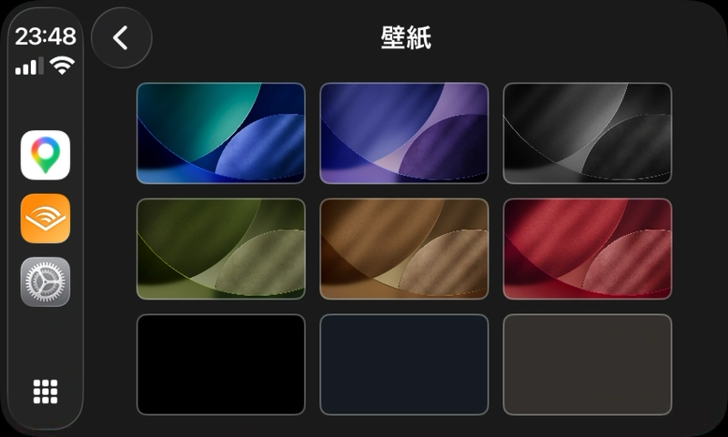

<p align="center">
  
</p>

<h1 align="center">CarCanvas</h1>

<p align="center">
  <a href="README.md">English</a> ·
  <strong>简体中文</strong> ·
  <a href="README.ja.md">日本語</a>
</p>

用自己的照片替换 CarPlay 壁纸，支持原始缓存备份与恢复。基于 [worse_query](https://github.com/forcequitOS/worse_query)。

## 使用要求

- iOS **26.0–26.7.2** 或 **27.0–27.2.1**。
- 未签名 IPA 需用支持 App Group 的工具签名，例如 SideStore、AltStore 或 Impactor。

## 安装

未签名 IPA 需要自备 Apple ID 签名。用软件源最省事，装一次之后随版本更新：

```
https://linkpass888.github.io/Sideload/source.json
```

在 [AltStore](https://altstore.io/)、SideStore 或 Feather 里添加这个源，之后直接在源里安装与更新。也可以打开 [侧载入口页](https://linkpass888.github.io/Sideload/) 点按钮自动加源。源里还有 Kazumi 与 AirBeep。

也可以从 [Releases](https://github.com/LinkPass888/CarCanvas/releases/latest) 手动下载 `CarCanvas-v*-unsigned.ipa`，用支持 App Group 的工具签名安装。

## 五步上手

1. 在 CarPlay **设置 → 壁纸**中选择图案壁纸生成缓存。**系统最多只缓存 6 个壁纸。**

   

2. 打开 CarCanvas 的 **CarPlay** 页，点 **重试**。
3. 点目标文件的预览选择照片。每个文件单独修改，先在本地暂存。
4. 点 **应用**，写入待处理修改。
5. 等待界面重载后，重新连接 CarPlay 查看壁纸。

## 已知限制

- **无法区分车机。** CarPlay 的配对记录位于 `/var/mobile/Library/Preferences/com.apple.carplay.plist`，不在任何应用容器内。`worse_query` 只为容器路径签发沙箱扩展，`cfprefsd` 也拒绝该系统域，因此应用无法判断哪个缓存属于哪台车，所有缓存会一起列出。
- **最多 6 个缓存壁纸。** CarPlay 只保留当前在壁纸选择器中选中的壁纸，因此缓存目录最多有 6 个文件，而不是历史上用过的全部壁纸。

## 备份与维护

- 新发现的缓存会自动备份。单文件或统一 **恢复** 后，再点 **应用** 生效。
- 预览旁的 **清空** 只撤销待应用修改，不删除系统缓存。
- 设置中的 **清除缓存** 会永久删除壁纸缓存、全部备份及修改状态，保留旧导出和历史记录。这是维护操作，不是上手步骤。

## 构建

使用 Xcode 26 与 XcodeGen，或通过 GitHub Actions 构建。仓库只保存源码，IPA 由 CI 生成。

```sh
brew install xcodegen
xcodegen generate
bash scripts/build-unsigned-ipa.sh
```

## 许可与致谢

[GPL-3.0-or-later](LICENSE) · [组件许可](THIRD_PARTY_LICENSES/README.md)

感谢 [worse_query](https://github.com/forcequitOS/worse_query) 与 [原始 CarCanvas](https://github.com/Dcsyhi1998/CarCanvas)。

[Telegram 频道](https://t.me/linkpass666) · [爱发电](https://afdian.com/a/linkpass)

仅用于自己的设备，操作前请备份。非 Apple 官方产品。
